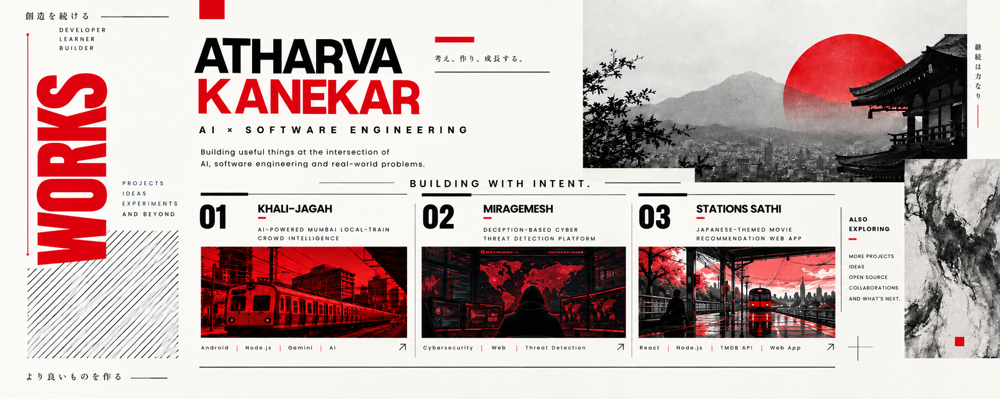

<!-- Neo-Japanese editorial hero artwork.
     Upload assets/profile-hero.png to your profile repository. -->

　[HOME](https://github.com/atharvakanekar22-dev)　 🟥 　 [PROJECTS](#selected-works)　 🟥 　 [CONTACT ↗](https://www.linkedin.com/in/atharvakanekar/)　 🟥

---

## SELECTED WORKS / 01—03

<table>
<tr>
<td width="33%" valign="top">

### 01 / KHALI-JAGAH

**AI × Mumbai Mobility**

AI-powered Mumbai local-train crowd intelligence, with an Android app, coach-level crowd data, and Gemma-powered travel insights.

`ANDROID` `KOTLIN` `NODE.JS` `GEMMA`

[↗ OPEN PROJECT](https://github.com/atharvakanekar22-dev/Khali-Jagah)

</td>
<td width="33%" valign="top">

### 02 / MIRAGEMESH

**Cybersecurity × Deception**

A deception-based cyber threat detection platform exploring security-focused monitoring and threat detection.

`CYBERSECURITY` `WEB` `THREAT DETECTION`

[↗ OPEN PROJECT](https://miragemesh.onrender.com/overview)

</td>
<td width="33%" valign="top">

### 03 / STATION SATHI

**AI × Platform Locator**

A railway station navigation and facility discovery platform designed to help commuters find essential facilities and navigate stations more easily.

`REACT` `NODE.JS` `TMDB API` `WEB APP`

[↗ OPEN PROJECT](https://github.com/atharvakanekar22-dev/StationSathi)

</td>
</tr>
</table>

