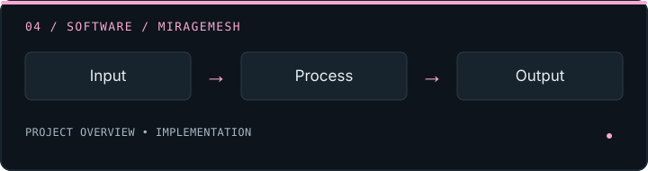

<!-- =========================================================
     ATHARVA'S GITHUB PROFILE README
     Replace YOUR_GITHUB_USERNAME and verify project links.
========================================================== -->

<picture>
  <source
    media="(prefers-reduced-motion: reduce)"
    srcset="https://capsule-render.vercel.app/api?type=waving&color=0:101827,100:2563EB&height=220&section=header&text=Atharva%20Kanekar&fontSize=38&fontColor=FFFFFF&animation=fadeIn&fontAlignY=38"
  />
  
</picture>

  
  
  

  

I am an **MCA student and aspiring software developer** interested in artificial intelligence, full-stack development, Android applications, and solving practical problems through technology.

I enjoy taking an idea from concept to implementation — designing interfaces, building APIs, connecting databases, integrating AI models, and testing the complete application.

My current focus is on strengthening my software engineering fundamentals while building projects that demonstrate practical problem-solving, experimentation, and continuous learning.

  <a href="#selected-projects"><strong>Projects</strong></a>
  &nbsp; / &nbsp;
  <a href="#tech-stack"><strong>Tech stack</strong></a>
  &nbsp; / &nbsp;
  <a href="#engineering-principles"><strong>Engineering</strong></a>
  &nbsp; / &nbsp;
  <a href="#lets-connect"><strong>Connect</strong></a>

---

## Selected Projects

Building practical software across AI, cybersecurity, Android, and web development — turning ideas into useful applications.

<table>
<tr>
<td width="50%" valign="top">

### 🚆 Khali-Jagah

AI-powered Mumbai local-train crowd intelligence with coach-level crowd information and AI travel insights.

`Kotlin` `Jetpack Compose` `Node.js` `Gemini API`

[**Repository →**](https://github.com/atharvakanekar22-dev/Khali-Jagah) · [**Download APK →**](https://github.com/atharvakanekar22-dev/Khali-Jagah/releases/tag/v1.1.0)

</td>
<td width="50%" valign="top">

### 🛡️ Sus Scam Detector

A cybersecurity project focused on identifying suspicious content and helping users assess potential online scams.

`Cybersecurity` `Web Development` `AI`

[**Repository →**](https://github.com/atharvakanekar22-dev/sus-scam-detector) · [**Live Demo ↗**](https://sus-scam-detector-4vsz.onrender.com/)

</td>
</tr>
<tr>
<td width="50%" valign="top">

### 🎬 StationSathi

A movie discovery and recommendation experience designed to help users explore films.

`React` `JavaScript` `Web Development`

[**Repository →**](https://github.com/atharvakanekar22-dev/StationSathi) · [**Live Demo ↗**](https://stationsathi.onrender.com/)

</td>
<td width="50%" valign="top">

### 🌐 MirageMesh

A software project exploring web technologies and practical application development.

`Software Engineering` `Web Development`

[**Repository →**](https://github.com/atharvakanekar22-dev/MirageMesh) · [**Live Demo ↗**](https://miragemesh.onrender.com/)

</td>
</tr>
</table>

---

[**Explore all repositories →**](https://github.com/atharvakanekar22-dev?tab=repositories)

  <a href="https://github.com/atharvakanekar22-dev?tab=repositories">
    <strong>Explore All My Repositories →</strong>
  </a>

