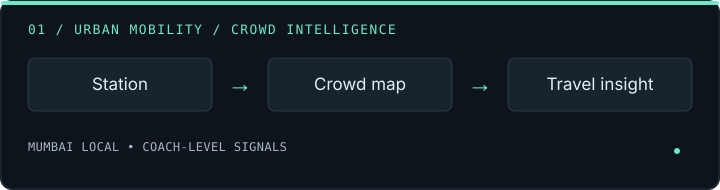
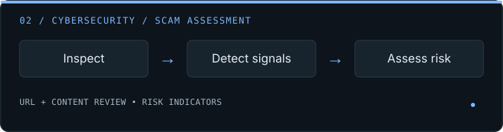
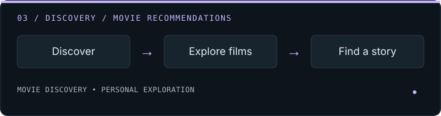
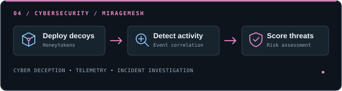

<!-- =========================================================
     ATHARVA'S GITHUB PROFILE README
     Replace YOUR_GITHUB_USERNAME and verify project links.
========================================================== -->

<picture>
  <source
    media="(prefers-reduced-motion: reduce)"
    srcset="https://capsule-render.vercel.app/api?type=waving&color=0:101827,100:2563EB&height=220&section=header&text=Atharva%20Kanekar&fontSize=38&fontColor=FFFFFF&animation=fadeIn&fontAlignY=38"
  />
  
</picture>

  

I am an MCA student in Mumbai, specializing in AI/ML. I build software for problems I see around me: crowded local trains, confusing railway stations and increasingly convincing online scams.

My work spans Android (Kotlin, Flutter), full-stack web development (TypeScript, React, Node.js), and Python backends. I prefer owning a project end to end: interface, API, database, model integration, and testing.

  <a href="https://www.linkedin.com/in/atharvakanekar/"><strong>Let's Connect ↗</strong></a>
  &nbsp;&nbsp; · &nbsp;&nbsp;
  <a href="https://unsplash.com/@atharvakanekar22"><strong>Other Works ↗</strong></a>

---

<h2 align="center">Selected Projects</h2>

<table>
<tr>
<td width="50%" valign="top">

### 🚂 Khali-Jagah

An Android application designed to help Mumbai local commuters make informed travel decisions through AI-powered crowd intelligence, station and train selection, and coach-level crowd analysis.

`Kotlin` `Jetpack Compose` `MVVM` `Retrofit` `Node.js` `Express.js` `Google GenAI SDK` `Gemma 4`

[**Repository →**](https://github.com/atharvakanekar22-dev/Khali-Jagah) · [**Download APK →**](https://github.com/atharvakanekar22-dev/Khali-Jagah/releases/tag/v1.1.0)

</td>
<td width="50%" valign="top">

### 🛡️ Sus Scam Detector

A web-based cybersecurity application that helps users assess potentially fraudulent online content by identifying suspicious indicators and presenting insights to support safer digital decision-making.
`TypeScript` `React` `Node.js` `Express.js` `AI Integration` `Cybersecurity`

[**Repository →**](https://github.com/atharvakanekar22-dev/sus-scam-detector) · [**Live Demo ↗**](https://sus-scam-detector-4vsz.onrender.com/)

</td>
</tr>
<tr>
<td width="50%" valign="top">

### 🚉 StationSathi

An Indoor railway-station assistance platform designed to simplify station navigation and improve the passenger experience by making station-related information easier to access.

`React` `Vite` `JavaScript` `Python` `FastAPI` `Tailwind CSS` `Dijkstra's Algorithm` 

[**Repository →**](https://github.com/atharvakanekar22-dev/StationSathi) · [**Live Demo ↗**](https://stationsathi.onrender.com/)

</td>
<td width="50%" valign="top">

### 🌐 MirageMesh

A deception-based cybersecurity platform that uses synthetic decoys and honeytokens to detect suspicious activity, correlate security events, and assess potential threats through deterministic risk scoring. Features attack simulation, incident investigation, telemetry monitoring, and simulated containment actions.

`TypeScript` `React` `Node.js` `Express.js` `MongoDB`

[**Repository →**](https://github.com/atharvakanekar22-dev/MirageMesh) · [**Live Demo ↗**](https://miragemesh.onrender.com/)

</td>
</tr>
</table>

---

  <a href="https://github.com/atharvakanekar22-dev?tab=repositories">
    <strong>Explore All My Repositories →</strong>
  </a>

